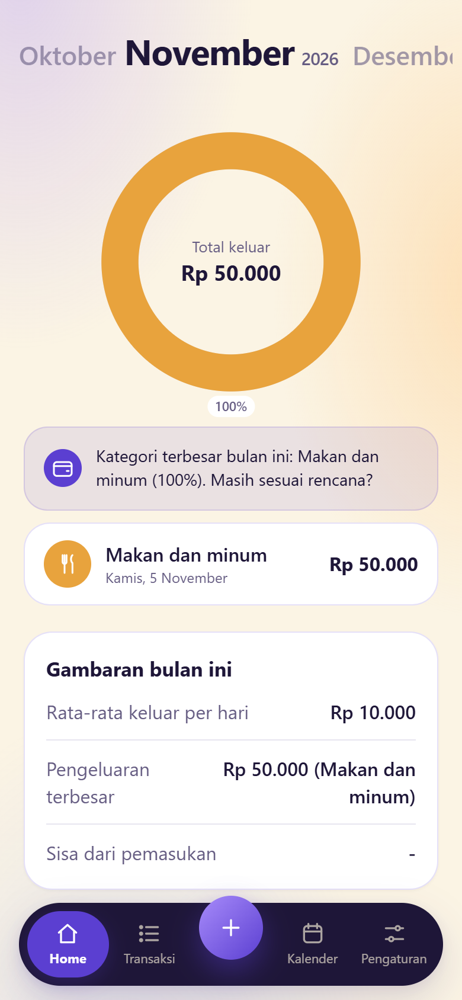
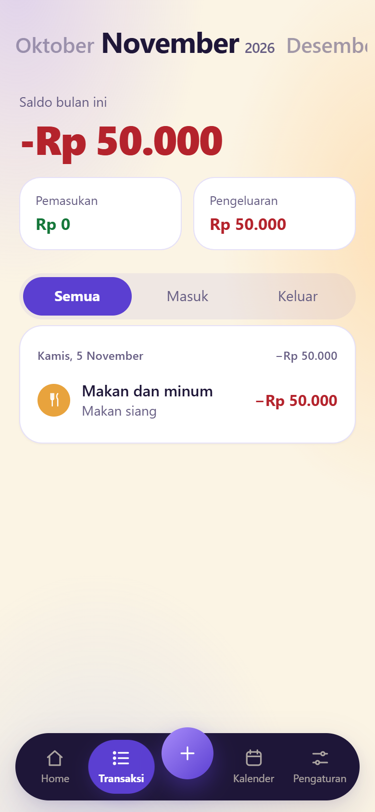
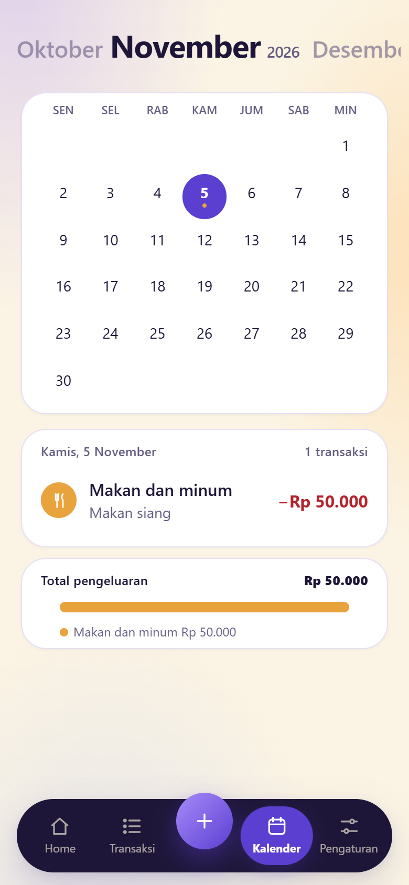
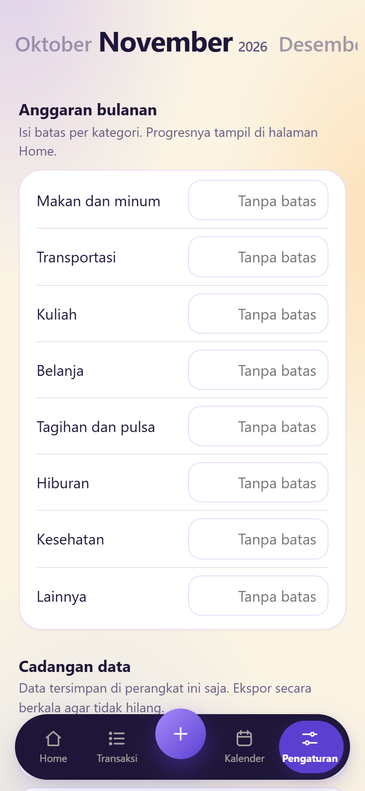
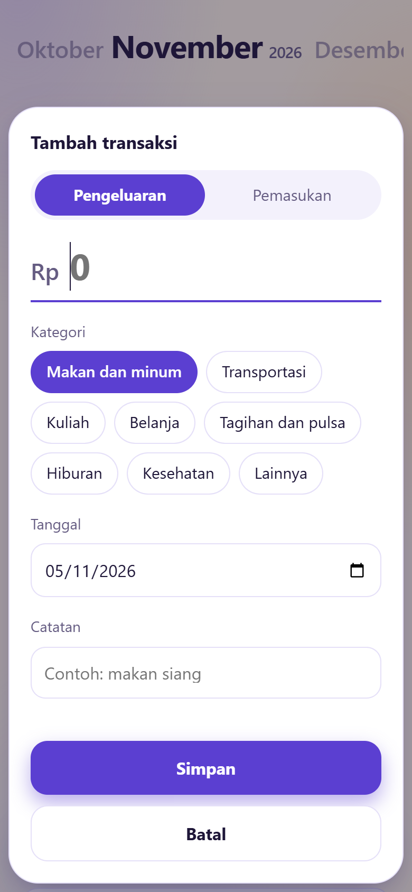
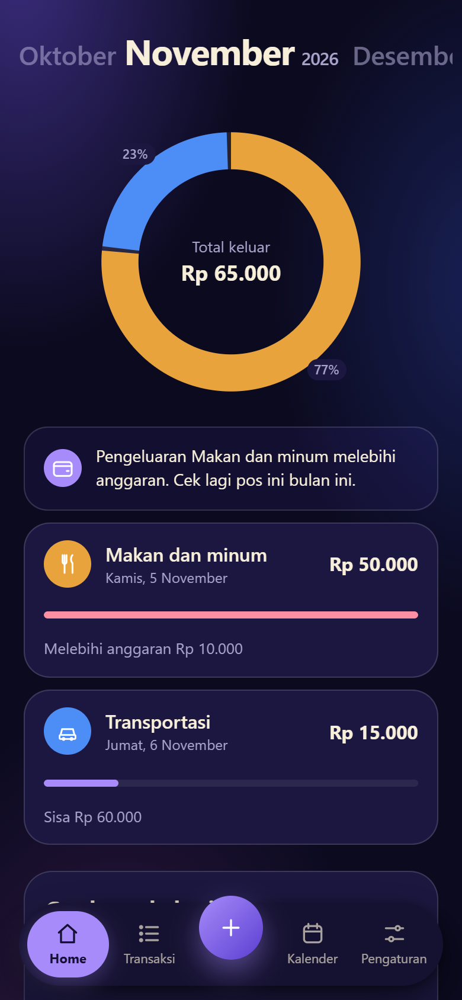
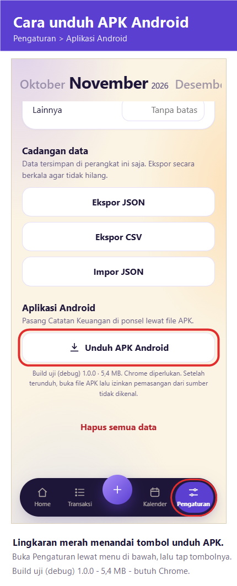

# Catatan Keuangan

[](https://winduathallahahmad-09.github.io/Pencatat-Keuangan-Pribadi/)
[](#download-and-install-on-android)
[](#data-and-offline-support)
[](#technology)

A private, offline-first personal finance tracker for recording income, expenses, budgets, and daily spending patterns. It is designed for students, freelancers, and anyone who wants a simple finance app without creating an account or sending financial data to a server.

The entire application is a single HTML file with inline CSS and vanilla JavaScript. There is no backend, no build step, and no third-party runtime dependency. All transactions are stored locally in the browser, so the app keeps working without an internet connection after its first load.

> **Android availability:** The app is distributed as a downloadable **APK** for Android. There is no Play Store listing. Download the APK from inside the app under **Pengaturan → Aplikasi Android**, or from the `downloads/` folder in this repository.

**Language note:** The app interface uses Indonesian labels such as **Transaksi**, **Kalender**, and **Pengaturan**. This README uses English and includes the visible Indonesian labels where they are relevant.

## Quick Links

- [Open the live application](https://winduathallahahmad-09.github.io/Pencatat-Keuangan-Pribadi/)
- [Download and install on Android](#download-and-install-on-android)
- [Features](#features)
- [Usage guide](#usage-guide)
- [Documentation and project links](#documentation-and-links)
- [Report an issue](https://github.com/WinduAthallahAhmad-09/Pencatat-Keuangan-Pribadi/issues)

## Screenshots

| Home dashboard | Transactions |
|:---:|:---:|
| <a href="docs/screenshots/home-light.png"></a> | <a href="docs/screenshots/transactions-light.png"></a> |
| **Calendar** | **Settings** |
| <a href="docs/screenshots/calendar-light.png"></a> | <a href="docs/screenshots/settings-light.png"></a> |

| Add transaction | Dark theme |
|:---:|:---:|
| <a href="docs/screenshots/add-transaction-light.png"></a> | <a href="docs/screenshots/home-dark.png"></a> |

## Features

### Home dashboard

- Monthly expense donut chart with category percentages.
- Total spending shown in the center of the chart.
- Contextual tips for over-budget categories and the largest spending category.
- Category cards with icons, latest transaction date, totals, and budget progress.
- Monthly statistics for daily average spending, largest expense, and remaining income.
- Empty states that guide first-time users to add a transaction.

### Transaction management

- Record income and expenses.
- Choose from built-in expense and income categories.
- Add a date and an optional note.
- Edit or delete an existing transaction.
- Filter the monthly list by **All**, **Income**, or **Expense**.
- Transactions are grouped by day with a monthly balance summary.

### Calendar

- Full Monday-to-Sunday monthly calendar.
- Category-colored dots on days that have expenses.
- Tap any date to view its transactions.
- Monthly expense total and a stacked category breakdown below the daily list.
- Navigate to previous or next months without leaving the page.

### Budgets

- Set a spending limit for each expense category.
- Track remaining or excess budget directly from the Home page.
- Receive a warning tip when a category exceeds its budget.
- Clear a budget by emptying its input field.

### Navigation and themes

- Four pages: **Home**, **Transactions**, **Calendar**, and **Settings**.
- Swipe horizontally between pages.
- Five-item bottom navigation: Home, Transactions, **+**, Calendar, and Settings.
- The central **+** button opens the add-transaction form from any page.
- Automatic light and dark themes based on the device preference.
- Mobile-first layout with optional desktop framing.
- Animated page transitions, navigation lens, and touch feedback.

### Data and offline support

- All data stays in the browser's `localStorage`.
- No account, cloud sync, analytics, or server-side database.
- Android APK available for download inside the app.
- Offline app-shell caching through a service worker in the browser version.
- JSON export for full backups and restoration.
- CSV export for Excel, Google Sheets, or other spreadsheet tools.
- Confirmation dialog before deleting all data.

## Download and Install on Android

The Android app is distributed as an APK file. Install it directly on the phone; no Play Store account is required.

### Requirements

- An Android phone running Android 7.0 (API 24) or newer.
- **Google Chrome** installed. The APK opens the live app through Chrome.
- An internet connection for the first launch.
- Permission to install apps from unknown sources.

### Visual installation guide

The screenshot below shows where to find the APK download button in the app. Both the **Pengaturan** tab and the **Unduh APK Android** button are marked with a red circle.

<p align="center">
  <a href="docs/screenshots/apk-download-guide.png">
    
  </a>
</p>

### Installation steps

1. Open the [live application](https://winduathallahahmad-09.github.io/Pencatat-Keuangan-Pribadi/) in **Chrome** on your Android phone.
2. Tap **Pengaturan** in the bottom navigation.
3. Scroll to the **Aplikasi Android** section.
4. Tap **Unduh APK Android**. The file `Catatan-Keuangan-debug-1.0.0.apk` (5.4 MB) is saved to the Downloads folder.
5. Open the downloaded APK from the notification or from the **Files** app.
6. If Android blocks the installation, allow **Install unknown apps** for Chrome or the file manager, then return to the APK.
7. Tap **Install** and wait for the process to finish.
8. Open **Catatan Keuangan** from the Android home screen or app drawer.

You can also download [`downloads/Catatan-Keuangan-debug-1.0.0.apk`](downloads/Catatan-Keuangan-debug-1.0.0.apk) directly from this repository.

### About the debug build

The APK is a Trusted Web Activity wrapper around the live application, signed with the Android debug key. Install it only for testing. Installing a future release build requires uninstalling this debug build first.

### Updating the app

The APK loads the live web application, so interface updates arrive automatically. Open the app while connected to the internet. If an older version is still visible, close the app completely and open it again.

### Uninstalling the app

Long-press the app icon and choose **Uninstall**, or open **App info** and select **Uninstall**. Export a JSON backup before uninstalling if you want to keep your records.

## Usage Guide

### Navigation

| Position | Navigation item | Function |
|---|---|---|
| 1 | **Home** | Dashboard, chart, tips, category cards, and monthly statistics |
| 2 | **Transaksi** | Monthly transaction list and type filters |
| 3 | **+** | Open the add-transaction form |
| 4 | **Kalender** | Monthly calendar and daily transactions |
| 5 | **Pengaturan** | Budgets, export, import, and data reset |

You can tap a navigation item or swipe horizontally between adjacent pages.

### Add a transaction

1. Tap the central **+** button.
2. Choose **Pengeluaran** for an expense or **Pemasukan** for income.
3. Enter the amount in rupiah.
4. Select a category.
5. Choose a date.
6. Add an optional note.
7. Tap **Simpan**.

The amount must be greater than zero, and the date must be valid. After saving, the app switches to the month containing the transaction and refreshes all affected pages.

### Edit or delete a transaction

1. Open **Transaksi** or the daily list in **Kalender**.
2. Tap the transaction row.
3. Update the type, amount, category, date, or note.
4. Tap **Simpan** to keep the changes.
5. To remove the transaction, tap **Hapus transaksi** and confirm the deletion.

### Filter transactions

On the **Transaksi** page, use the segmented filter:

- **Semua** shows all transactions for the selected month.
- **Masuk** shows income only.
- **Keluar** shows expenses only.

### Read the Home dashboard

1. Open **Home**.
2. Review the donut chart to see how expenses are distributed by category.
3. Read the tip card for a budget warning or the largest spending category.
4. Use the category cards to compare category totals and budget usage.
5. Review the monthly statistics below the category cards.

If there are no expenses in the selected month, Home displays an empty state instead of the chart.

### Use the Calendar

1. Open **Kalender**.
2. Tap a date to display its transactions.
3. Category-colored dots indicate dates with expenses.
4. Review the selected day's transactions in the card below the calendar.
5. Scroll further to see the monthly expense total and category breakdown.
6. Tap a transaction row to edit or delete it.

### Navigate between months

Use the month controls in the header:

- Tap the previous month label to move back one month.
- Tap the next month label to move forward one month.
- Tap the current month title to return to the present month.

Changing the month also resets the selected calendar date to a valid default.

### Set a budget

1. Open **Pengaturan**.
2. Find **Anggaran bulanan**.
3. Enter a limit for an expense category.
4. Leave the field empty to remove that category's budget.

Budget progress appears on the Home page for categories with spending. When spending exceeds the limit, the app shows an over-budget warning and a red progress bar.

### Export a backup

1. Open **Pengaturan**.
2. Scroll to **Cadangan data**.
3. Tap **Ekspor JSON** to save a complete backup of transactions and budgets.
4. Tap **Ekspor CSV** to create a spreadsheet-friendly file.

On browsers that support file sharing, the export action may open the Android share sheet. Choose **Files** or another destination to save the file. Other browsers download the file directly.

### Import a backup

1. Open **Pengaturan**.
2. Tap **Impor JSON**.
3. Select a JSON file previously exported by this app.
4. Confirm the import.

The import merges new transactions into the existing data and does not delete current records. Duplicate transaction IDs are skipped. Imported budgets are merged into the current budget settings.

CSV files are intended for viewing and reporting; they cannot be imported back into the app.

### Reset all data

1. Open **Pengaturan**.
2. Tap **Hapus semua data**.
3. Confirm the warning.

This permanently removes all transactions and budgets from the current browser. Export a JSON backup first. The action cannot be undone.

## Data Storage and Privacy

- Transactions and budgets are stored only in the current browser profile.
- The app does not create an account or upload financial records.
- Clearing browser site data can erase the records.
- Uninstalling the browser or clearing its storage can also remove the data.
- JSON export is the recommended backup method.
- The app has no cloud synchronization, so data is not shared between devices automatically.
- Data opened from a local `index.html` file is stored under a different origin than the hosted app. To move data from an older local copy, export JSON from the old page and import it into the hosted app.

## Default Categories

### Expense categories

| Category | Indonesian label | Color |
|---|---|---|
| Food and drinks | Makan dan minum | Yellow |
| Transportation | Transportasi | Blue |
| Education | Kuliah | Purple |
| Shopping | Belanja | Pink |
| Bills and mobile top-up | Tagihan dan pulsa | Teal |
| Entertainment | Hiburan | Orange |
| Health | Kesehatan | Green |
| Other | Lainnya | Gray |

### Income categories

| Category | Indonesian label |
|---|---|
| Allowance | Uang saku |
| Salary | Gaji |
| Scholarship | Beasiswa |
| Freelance | Freelance |
| Other | Lainnya |

## Technology

| Technology | Role |
|---|---|
| **HTML5** | Semantic structure, dialogs, forms, and ARIA attributes |
| **CSS3** | Custom properties, responsive layout, themes, transitions, and animation |
| **Vanilla JavaScript** | State management, rendering, calendar logic, gestures, and data handling |
| **Web Storage API** | Local transaction and budget persistence |
| **Web App Manifest** | App name, colors, icons, scope, and standalone display mode |
| **Service Worker** | App-shell caching and offline navigation fallback |
| **Web Share API** | Native file sharing for exports when supported |
| **Node.js built-in test runner** | Unit tests for pure logic and markup contracts |

There is no package manager installation, framework, bundler, or production runtime dependency.

## Project Structure

```text
Pencatat Keuangan/
├── index.html                         # Entire app: HTML, CSS, and JavaScript
├── manifest.webmanifest               # PWA metadata and icons
├── sw.js                              # Offline service worker and cache policy
├── icons/
│   ├── icon-180.png                   # Apple touch icon
│   ├── icon-192.png                   # Standard PWA icon
│   ├── icon-512.png                   # High-resolution PWA icon
│   └── icon-maskable-512.png          # Android maskable icon
├── downloads/
│   └── Catatan-Keuangan-debug-1.0.0.apk  # Debug-signed Android APK
├── tests/
│   └── logic.test.mjs                 # Node.js unit tests
├── docs/
│   ├── screenshots/                   # Application screenshots used in this README
│   └── superpowers/
│       ├── specs/                     # Approved design specification
│       └── plans/                     # Step-by-step implementation plan
└── README.md                          # Project documentation
```

The application logic, styles, and markup all live in `index.html`. The manifest and service worker add installability and offline behavior.

## Run Locally

### Option 1: Serve with Python

```bash
python -m http.server 4173
```

Then open:

```text
http://localhost:4173
```

### Option 2: Serve with Node.js

```bash
npx serve .
```

Open the URL printed by the command. A local HTTP server is recommended because service workers require `localhost` or HTTPS.

Opening `index.html` directly with `file://` loads the interface, but PWA installation and service-worker caching will not work.

## Tests

Run the unit test suite with Node.js:

```bash
node --test tests/logic.test.mjs
```

The tests cover:

- Light and dark theme tokens.
- PWA manifest colors.
- Calendar cell generation, leap years, and date ordering.
- Four-page configuration and five-column navigation mapping.
- Navigation lens positioning.
- Four-pane markup and the absence of the legacy floating action button.
- Dashboard tip messages.
- Donut chart label calculations and small-segment filtering.
- Service worker cache version.

No package installation is required.

## Documentation and Links

| Resource | Link |
|---|---|
| Live application | [winduathallahahmad-09.github.io/Pencatat-Keuangan-Pribadi](https://winduathallahahmad-09.github.io/Pencatat-Keuangan-Pribadi/) |
| Android installation guide | [Annotated APK download screenshot](docs/screenshots/apk-download-guide.png) |
| Release notes | [v1.0.0](docs/release-notes/v1.0.0.md) |
| GitHub repository | [WinduAthallahAhmad-09/Pencatat-Keuangan-Pribadi](https://github.com/WinduAthallahAhmad-09/Pencatat-Keuangan-Pribadi) |
| Design specification | [Spendo layout and legacy purple theme](docs/superpowers/specs/2026-11-05-spendo-layout-legacy-theme-design.md) |
| Implementation plan | [Spendo layout implementation](docs/superpowers/plans/2026-11-05-spendo-layout-legacy-theme.md) |
| Automated tests | [tests/logic.test.mjs](tests/logic.test.mjs) |
| PWA manifest | [manifest.webmanifest](manifest.webmanifest) |
| Service worker | [sw.js](sw.js) |
| Screenshot documentation | [docs/screenshots](docs/screenshots) |
| Issue tracker | [GitHub Issues](https://github.com/WinduAthallahAhmad-09/Pencatat-Keuangan-Pribadi/issues) |
| GitHub Pages deployment | [Production site](https://winduathallahahmad-09.github.io/Pencatat-Keuangan-Pribadi/) |

## Troubleshooting

### The APK does not install

- Allow **Install unknown apps** for Chrome or the file manager in Android settings.
- If Play Protect shows a warning, choose **Install anyway**. The APK uses a debug signature.
- Check that the phone has enough free storage.
- If the download is incomplete, delete the file and download it again.

### The installed app still shows an older version

- Connect to the internet.
- Close the app completely and open it again.
- Reload the page once if Chrome is still displaying a cached version.

### Data is missing

Transactions are stored per browser origin. Check that you opened the same URL as before. If browser site data was cleared, restore the latest JSON backup from **Pengaturan**. Data cannot be recovered without a backup.

### Offline mode does not work

Open the hosted app online at least once so the service worker can cache the app shell. Service workers do not run from a direct `file://` page.

### Import fails

Use a JSON file that was exported by this app. Confirm that the file was not edited into invalid JSON and that it contains a `transactions` array.

## License

This project is open-source. You are free to use, modify, and distribute it as needed.
